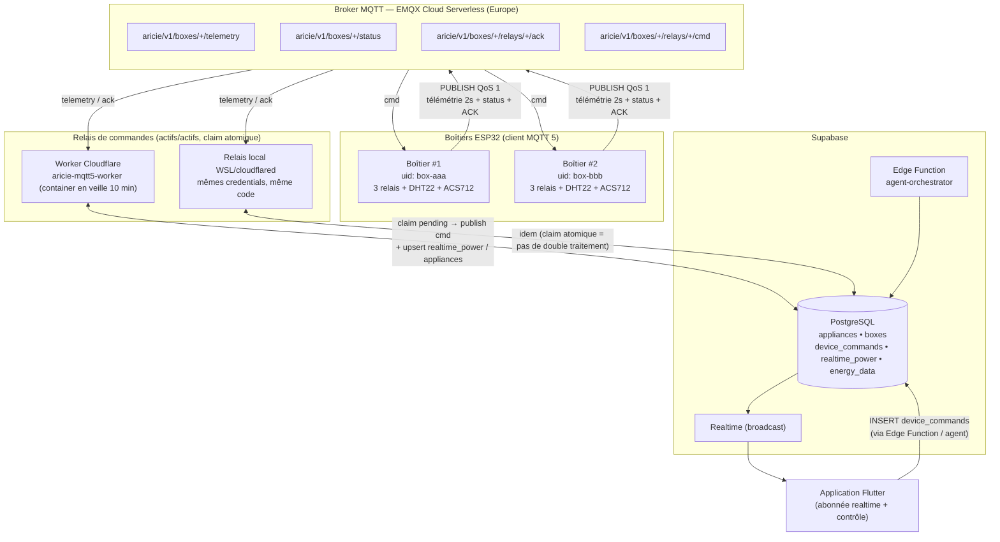
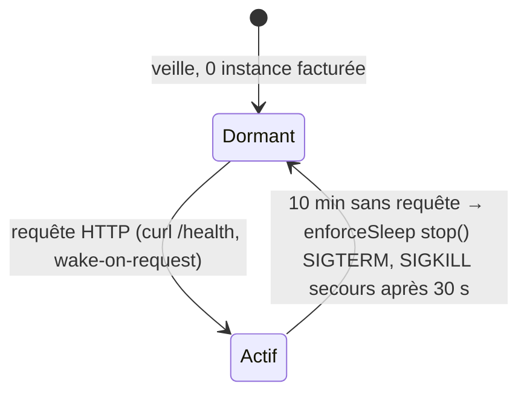
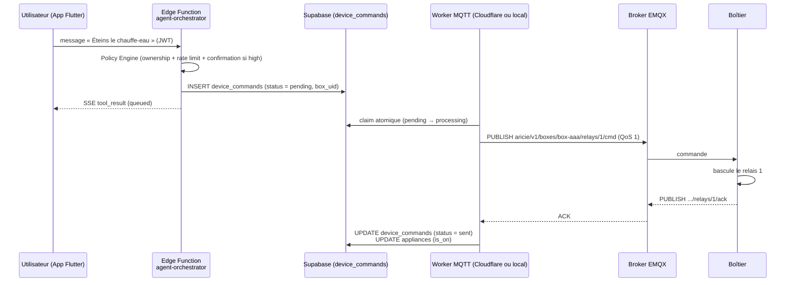
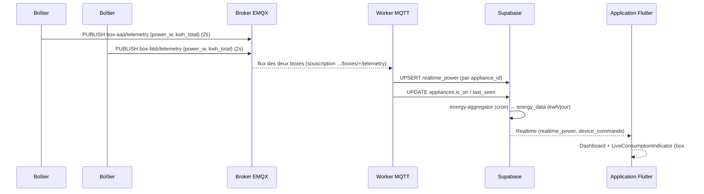

# Architecture — deux boîtiers, broker MQTT et base de données

Comment **deux boîtiers ESP32** (box #1 et box #2) communiquent et se
synchronisent avec la base de données Supabase **via le broker MQTT EMQX
Cloud Serverless** (`r1aa3902.ala.eu-central-1.emqxsl.com:8883`, TLS).

## Vue d'ensemble

## Cycle de vie du worker Cloudflare (coût)

Le container **ne tourne pas en permanence** : après **10 min sans requête**,
il passe en veille (`LIVE INSTANCES → 0`, plus de facturation) et se réveille
au prochain appel HTTP. Pendant la veille, le **relais local** assure la
continuité ; le claim atomique sur `device_commands` empêche tout double
traitement.

## Séquence : commande « Éteins le chauffe-eau » (box #1)

## Séquence : télémétrie des deux boîtiers → synchronisation BDD

## Topics MQTT 5 (namespace `aricie/v1/boxes/{uid}/…`)

| Topic | Producteur | Consommateur | Rôle |
|-------|-----------|--------------|------|
| `…/telemetry` | Boîtier | Worker, App (abonnement) | puissance instantanée, énergie cumulée, DHT22 |
| `…/status` | Boîtier | Worker, App | heartbeat, version firmware, état WiFi |
| `…/relays/{i}/cmd` | Worker | Boîtier | commande relay (on/off) |
| `…/relays/{i}/ack` | Boîtier | Worker | accusé de réception (→ `device_commands.status = sent`) |

## Règles clés

- **L'app Flutter ne publie jamais sur MQTT** : toute commande passe par la
  file `device_commands` (BDD), relaie par le worker → broker.
- **Les deux workers (Cloudflare + local) sont actifs/actifs** : le claim
  atomique `UPDATE … WHERE status = 'pending' RETURNING` garantit qu'une
  commande n'est envoyée qu'une seule fois.
- **Chaque boîtier est identifié par `uid_hardware`** (table `boxes`), les
  appliances sont scopées par `box_id` et `user_id` (RLS).
- **La synchronisation BDD est unidirectionnelle montante** (télémétrie →
  `realtime_power` / `appliances`) et bidirectionnelle pour les commandes
  (BDD → MQTT → boîtier → ACK → BDD).
