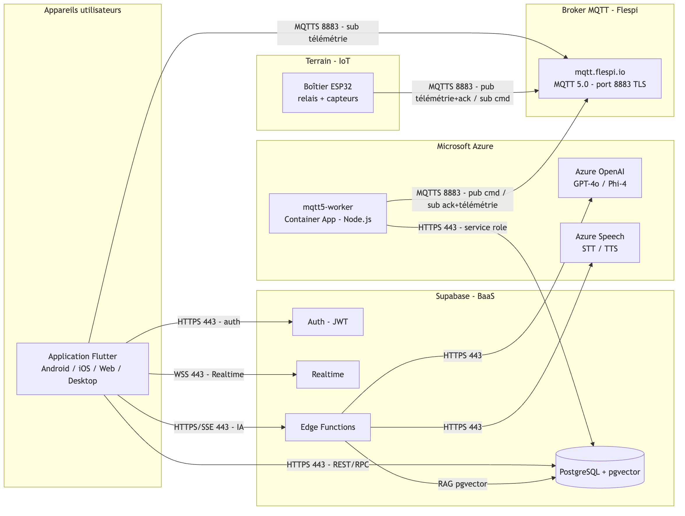
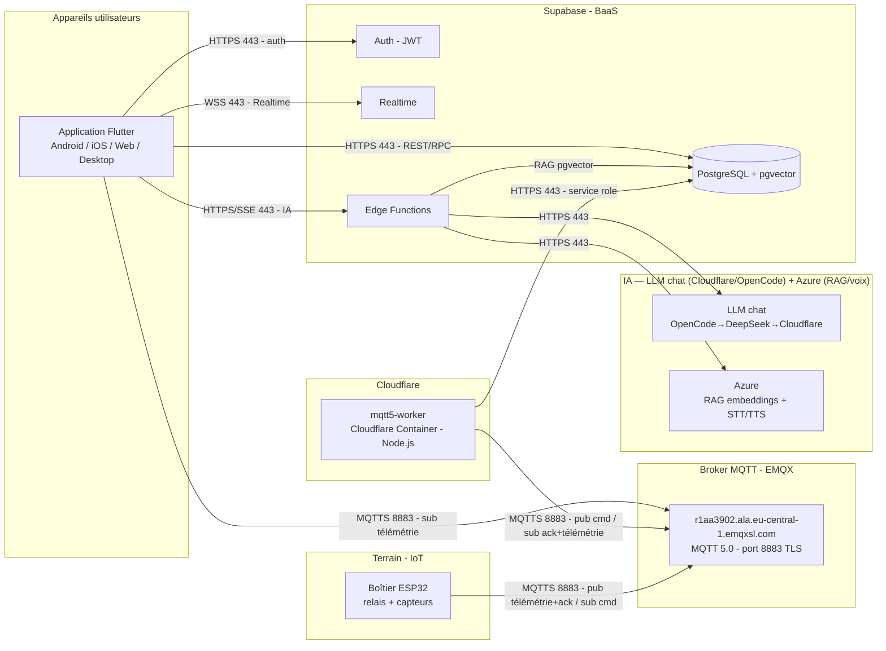
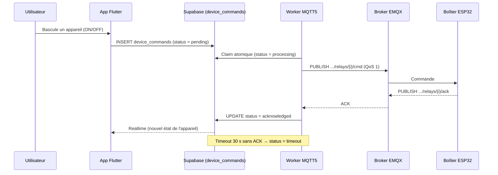
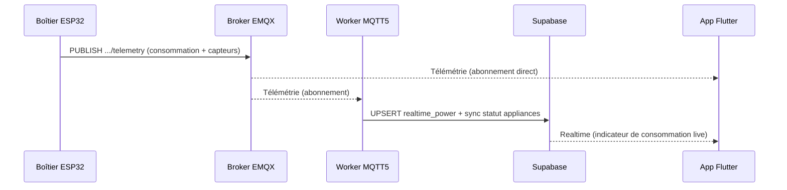
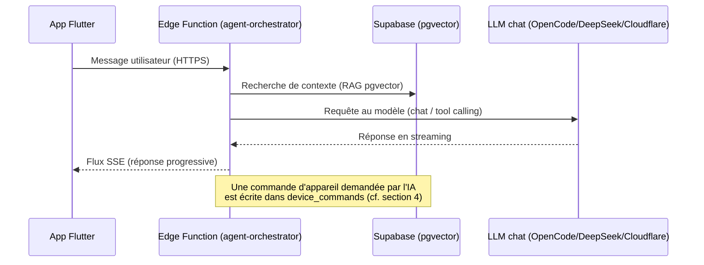

# Topologie et architecture réseau — Aricie

> La **topologie réseau** (section 2) est un diagramme **draw.io**
> (`diagrams/01-topologie-reseau.drawio`). Les **diagrammes de flux** (sections
> 4 à 6) sont au format **Mermaid** : lisibles tels quels sur GitHub, ou dans
> VS Code avec l'extension « Markdown Preview Mermaid Support ».

## 1. Vue d'ensemble

> **Mises à jour d'infrastructure (oct. 2026)** — broker MQTT **Flespi → EMQX
> Cloud Serverless**, worker MQTT5 **Azure Container Apps → Cloudflare
> Containers**, et scission de l'IA : le **chat / tool-calling** est migré hors
> Azure (**OpenCode → DeepSeek → Cloudflare Workers AI**) ; les **embeddings
> RAG et la voix (STT/TTS) restent sur Azure** (migration en attente). Le
> diagramme **draw.io exporté** (`diagrams/01-topologie-reseau.png`) et sa
> source `.drawio` reflètent l'ancien état et doivent être régénérés
> manuellement.

Aricie est une solution de suivi et de pilotage de la consommation d'énergie
composée de cinq acteurs réseau :

| Acteur | Rôle | Hébergement |
|--------|------|-------------|
| **Application Flutter** | Interface utilisateur (Android / iOS / Web / Desktop) | Appareils clients |
| **Supabase** | Authentification, base PostgreSQL (+ pgvector), Realtime, Edge Functions | Cloud managé |
| **Broker MQTT EMQX** | Bus de messages IoT (MQTT 5.0) | EMQX Cloud Serverless (Europe) |
| **Worker MQTT5** | Pont entre la file de commandes et les boîtiers | Cloudflare Containers |
| **Boîtier ESP32** | Mesure la consommation et pilote les relais | Terrain (chez l'utilisateur) |
| **LLM chat / tool calling** | Agent IA (OpenCode → DeepSeek → Cloudflare) | Cloud (OpenCode Zen, Workers AI) |
| **Azure OpenAI / Speech** | Embeddings RAG + voix (STT/TTS) — migration en attente | Cloud Azure |

## 2. Schéma de topologie réseau

> Diagramme source (éditable) :
> [`diagrams/01-topologie-reseau.drawio`](diagrams/01-topologie-reseau.drawio)
> — l'ouvrir sur [diagrams.net](https://app.diagrams.net), puis
> `Fichier ▸ Exporter ▸ PNG` vers `diagrams/01-topologie-reseau.png`.

La topologie représente l'**infrastructure réseau** (équipements et liens), et
non les modules logiciels. Elle distingue quatre **segments** :

1. **LAN domestique de l'utilisateur** (`192.168.1.0/24`) : seul le **boîtier
   ESP32** y est ancré, raccordé en **Wi-Fi** à la **box Internet / routeur**
   qui assure la sortie **WAN** vers Internet.
2. **Postes clients** (smartphone / tablette / PC exécutant l'application
   Flutter) : **mobiles**, ils accèdent au système **depuis n'importe quel
   réseau** (Wi-Fi domestique, autre Wi-Fi, 4G/5G). L'app ne joint jamais le
   boîtier en direct : elles se rejoignent **via le cloud**, donc le **pilotage
   à distance (ON/OFF) fonctionne où que soit l'utilisateur**, sans ouverture
   de port sur la box (connexions **sortantes** de part et d'autre).
3. **Internet** : média de transport chiffré entre le site utilisateur, les
   postes clients et les plateformes cloud.
4. **Clouds fournisseurs**, chacun un segment distinct : **EMQX** (broker
   MQTT), **Supabase** (serveur applicatif + base PostgreSQL/pgvector),
   **Cloudflare** (worker MQTT5 + IA chat via Workers AI) et **Microsoft
   Azure** (embeddings RAG + voix STT/TTS, migration en attente).

Chaque **lien** porte le **protocole et le port** réellement utilisés ; les
liens en pointillés sont les échanges **cloud-à-cloud** (backbone), les liens
pleins partent du site utilisateur.

### 2.1 Vue logique complémentaire (architecture applicative)

> Cette vue n'est **pas** la topologie réseau : elle montre, à titre
> complémentaire, quelles briques **logicielles** dialoguent entre elles.

## 3. Tableau des flux réseau

| Source | Destination | Protocole | Port | Usage |
|--------|-------------|-----------|------|-------|
| Application | Supabase (Auth, DB, Realtime, Edge Functions) | HTTPS / WSS | 443 | Connexion, lecture/écriture des données, temps réel, appels IA |
| Application | Broker EMQX | MQTTS (TCP TLS) | 8883 | Abonnement à la télémétrie et au statut des appareils |
| Worker MQTT5 | Supabase | HTTPS (clé *service role*) | 443 | Lire `device_commands`, écrire `realtime_power`, synchroniser `appliances` |
| Worker MQTT5 | Broker EMQX | MQTTS | 8883 | Publier les commandes, s'abonner aux ACK et à la télémétrie |
| Boîtier ESP32 | Broker EMQX | MQTTS | 8883 | Publier télémétrie/ACK, s'abonner aux commandes |
| Edge Functions | LLM chat (OpenCode/DeepSeek/Cloudflare) | HTTPS | 443 | Chat + tool calling (agent-orchestrator) |
| Edge Functions | Azure OpenAI / Azure Speech | HTTPS | 443 | Embeddings RAG + voix (STT/TTS) — migration en attente |

**Convention des topics MQTT :**
- Télémétrie : `aricie/v1/boxes/{boxUid}/telemetry`
- Commande : `aricie/v1/boxes/{boxUid}/relays/{relayIndex}/cmd`
- Accusé (ACK) : `aricie/v1/boxes/{boxUid}/relays/{relayIndex}/ack`

## 4. Flux : pilotage d'un appareil (toggle ON/OFF)

Une commande utilisateur ne part **jamais** directement de l'application vers le
boîtier : elle transite par une **file d'attente** (`device_commands`) traitée
par le worker. Cela garantit la traçabilité et découple l'app du matériel.

## 5. Flux : télémétrie temps réel

## 6. Flux : agent IA (chat / vocal)

## 7. Sécurité réseau

- **Chiffrement de bout en bout** : tout le trafic est chiffré — HTTPS/WSS (443)
  côté application et Edge Functions, MQTTS/TLS (8883) côté IoT.
- **Authentification** :
  - Application → Supabase : **JWT** utilisateur, avec **RLS** (Row Level
    Security) isolant les données par propriétaire.
  - Worker → Supabase : clé **service role** (backend de confiance), qui
    contourne la RLS pour traiter la file de commandes.  - Accès MQTT : **credentials EMQX** (`MQTT_USERNAME` / `MQTT_PASSWORD`) distincts pour l'application et pour le worker.
- **Identité des boîtiers** : appairage via **UID matériel** (paire unique
  boîtier ↔ utilisateur), vérifié côté backend.

## 8. Hébergement et déploiement

- **Supabase** : plateforme managée (Auth, PostgreSQL + pgvector, Realtime,
  Edge Functions).
- **Worker MQTT5** : conteneur Docker (`node:22-alpine`) déployé sur
  **Cloudflare Containers** (build + push d'image par `wrangler deploy` sur
  `registry.cloudflare.com`).
- **Broker MQTT** : service cloud **EMQX Cloud Serverless** (Europe, ports 8883 / WSS 8084).
- **IA (chat / tool calling)** : **OpenCode → DeepSeek → Cloudflare Workers
  AI**, appelés depuis les Edge Functions (`llm.ts`).
- **IA (RAG embeddings + voix)** : encore **Azure OpenAI / Azure Speech**
  (STT/TTS), migration hors Azure en attente.

## 9. Choix et comparatif des technologies

Les technologies ont été retenues au regard des contraintes du projet (contexte
africain : bande passante parfois limitée, coûts à maîtriser, matériel
contraint) et de la rapidité de mise en œuvre.

| Besoin | Alternatives envisagées | Choix retenu | Justification |
|--------|-------------------------|--------------|---------------|
| Communication temps réel avec des objets contraints | HTTP (polling), CoAP, WebSocket brut | **MQTT 5.0** | Pub/sub léger, faible consommation de bande passante, bidirectionnel, QoS et ACK ; adapté à l'IoT et aux réseaux instables |
| Broker MQTT | Mosquitto auto-hébergé, HiveMQ, AWS IoT Core | **EMQX Cloud Serverless (cloud managé)** | TLS et credentials intégrés, support natif MQTT 5, palier gratuit, aucune administration de serveur |
| Backend (données, auth, temps réel) | Firebase, backend sur-mesure (Node/Django), AWS Amplify | **Supabase** | PostgreSQL relationnel (adapté aux données de consommation) + RLS + pgvector (RAG), Auth et Realtime intégrés, open-source, palier gratuit |
| Transmission des commandes appareil | Publication MQTT directe app → broker | **File `device_commands` (via la base)** | Traçabilité, sécurité (RLS), fiabilité (claim atomique, ACK, timeout) ; l'application n'a pas à exposer le jeton du broker |
| Exécution du pont IoT | Edge Function éphémère, tâche cron, VM dédiée | **Worker Node.js sur Cloudflare Containers** | Un processus persistant est nécessaire (connexion MQTT et écoute des ACK en continu), scalable et sans gestion de VM |
| Intelligence artificielle | OpenAI direct, LLM auto-hébergé (Ollama) | **OpenCode → DeepSeek → Cloudflare Workers AI (chat) + RAG pgvector** | Modèles récents et GRATuits (free tier), RAG réutilisant PostgreSQL (pas de base vectorielle séparée à maintenir) ; embeddings/voix encore Azure en attendant une migration |
| Application cliente | React Native, natif Android + iOS, PWA | **Flutter** | Base de code unique multi-plateformes (Android, iOS, Web, Desktop), bonnes performances, interface riche |

> Ces choix privilégient des services **managés** (EMQX, Supabase, Cloudflare, Azure) pour
> réduire la charge d'exploitation et sécuriser le prototype, tout en gardant des
> composants **open-source / standards** (MQTT, PostgreSQL, Flutter) pour limiter
> la dépendance à un fournisseur unique.
